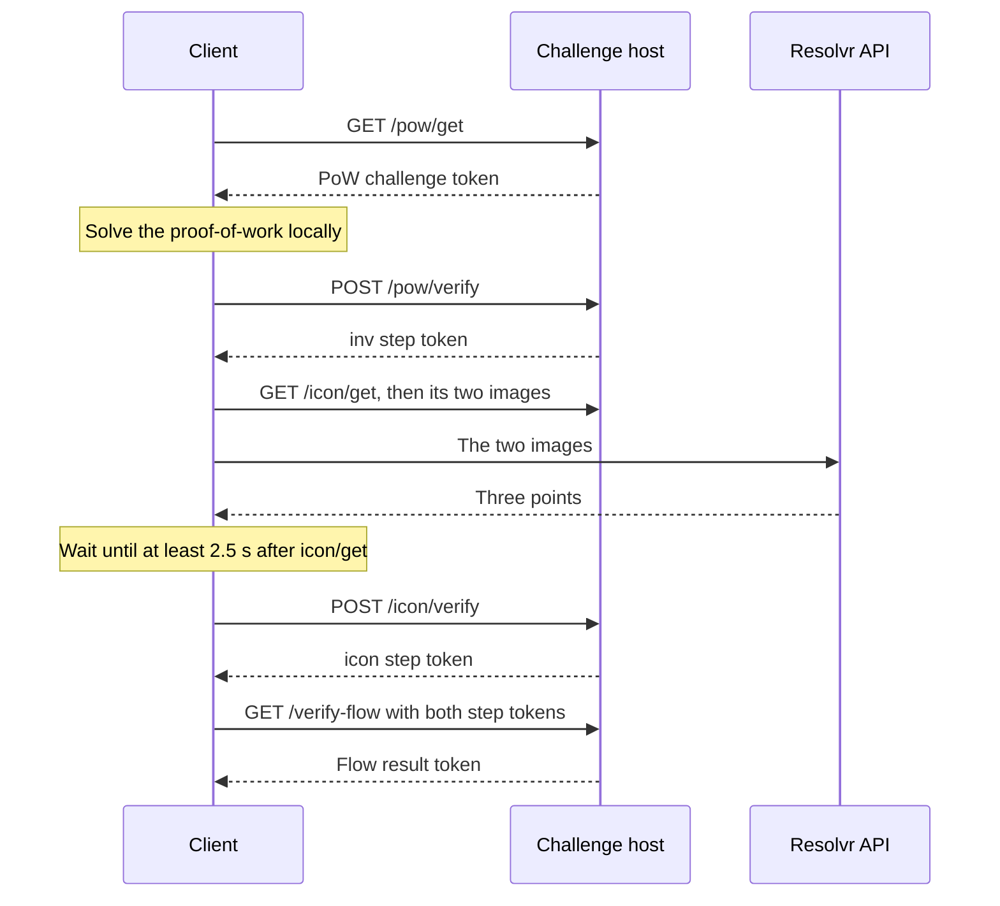
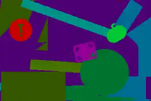

<div align="center">

[](pow/rust)
[](poc)
[](poc)
[](#the-resolvr-api)

</div>

BotDeflector is a challenge that Queue-it presents in front of protected pages and waiting rooms. A client must complete two steps to pass it: a proof-of-work computation (`inv`) and an icon selection task (`icon`). This repository describes the protocol of the challenge and provides a reference client that completes it. The proof-of-work is solved locally by an open-source solver, which is available in Rust and in TypeScript. The icon selection task is solved by the Resolvr API, which receives the two challenge images and returns the positions of the three icons.

| Step | Answer sent by the client | Solved by | Typical duration |
| --- | --- | --- | --- |
| `inv`, proof-of-work | The edge indices of a cycle of eight edges in a graph derived from SHA-256 | [`pow/`](pow), locally | About 2 ms in Rust, about 28 ms in TypeScript |
| `icon`, icon selection | Three points on an image of 300 × 200 pixels | The [Resolvr API](#the-resolvr-api) | 6 to 22 ms |

This repository is a proof of concept published by [Resolvr](https://resolvr.com/?ref=github). The repository serves the following purposes:

- Developers can run a complete flow on their own machine and inspect every request that the client sends.
- The proof-of-work solver can be integrated into an existing client written in Rust or TypeScript.
- The documentation specifies what each step of the challenge sends and receives.
- A coding agent can add BotDeflector support to another codebase by following [AGENTS.md](AGENTS.md).

## The challenge flow

A BotDeflector flow consists of four steps:

1. **Flow token.** The page that displays the widget contains two configuration values: the flow token (`botDeflectorJwtToken`) and the address of the challenge host (`botDeflectorSource`, usually `dual.challenge.queue-it.net`). The flow token is a JSON Web Token that lists the steps of the flow, usually `inv` followed by `icon`. The token expires 120 seconds after the page has loaded.
2. **Proof-of-work (`inv`).** The client requests a [proof-of-work](#the-proof-of-work) with `GET /pow/get`, computes the answer, and submits it with `POST /pow/verify`. The challenge host responds with a step token.
3. **Icon selection (`icon`).** The client requests an [icon challenge](#the-icon-challenge) with `GET /icon/get` and downloads the two images that the challenge names. The client then determines the positions of the three icons and submits them with `POST /icon/verify`, no earlier than 2.5 seconds after the `icon/get` request. The challenge host responds with a second step token.
4. **Flow result.** The client sends both step tokens with `GET /verify-flow` and receives the flow result token (`ChallengeFlowResult`).

The following diagram shows the sequence of requests:



The following table lists each request of a flow, the data that the client sends, and the response of the challenge host:

| Request | Data sent by the client | Response of the challenge host |
| --- | --- | --- |
| `GET /pow/get` | Header `x-tt-flow-token` | `challengeToken` |
| `POST /pow/verify` | `solution`, `params`, `solution_fingerprint`, `time` (seconds, with three decimals), `challengeToken`, `challengeFlowToken` | `token` |
| `GET /icon/get` | Header `x-tt-flow-token` | `challengeToken` |
| `GET /icons/{lib}/ico/{ico}`, `GET /icons/{lib}/bgnd/{img}` | None | The two images |
| `POST /icon/verify` | `solution`, `solution_fingerprint`, `time` (milliseconds), `challengeToken`, `challengeFlowToken` | `token` |
| `GET /verify-flow` | Headers `x-tt-ch-flow-token`, `x-tt-client-fingerprint`, `x-tt-solution-tokens` | `ChallengeFlowResult` |

All requests of a flow carry the same visitor identifier, which the client sends as `solution_fingerprint` in the request bodies and as `x-tt-client-fingerprint` in the `verify-flow` request. All requests also carry the headers that Chrome sends, in the order in which Chrome sends them. The file [`poc/fixture/flow.json`](poc/fixture/flow.json) records every request that a browser sent during one flow, and the file [`poc/solve.ts`](poc/solve.ts) implements the four steps, with one function for each step.

## Running the demonstration

The demonstration requires Node.js 24. Node.js runs the TypeScript sources directly, so no installation step is necessary.

```bash
git clone https://github.com/resolvrlabs/botdeflector-solver
cd botdeflector-solver
export RESOLVR_API_KEY=...   # see "Obtaining an API key" below
npm run demo
```

The demonstration runs the reference client against a local server that imitates the page and the challenge host. The server replays a challenge that was captured from a browser session ([`poc/fixture`](poc/fixture)) and applies the same checks as Queue-it. The server verifies the proof-of-work answer, the tokens, the use of a single visitor identifier, the minimum delay of 2.5 seconds, and that each click lies within 12 pixels of the click that Queue-it accepted. The client solves the proof-of-work locally and sends the two images to the Resolvr API. A typical run produces the following output:

```
  0.01s  page        flow token read, challenge host dual.challenge.queue-it.net
  1.52s  pow         solved locally in 52 ms (3 challenges)
  1.76s  pow         pow/verify accepted
  1.82s  icon        Resolvr solved it in 9 ms (64 ms round trip): [{"x":231,"y":67},{"x":40,"y":59},{"x":168,"y":103}]
  1.82s  icon        waiting 3.1 s: icon/verify is refused within 2.5 s of icon/get
  4.97s  icon        icon/verify accepted after 3201 ms
  4.97s  verify-flow flow result for inv,icon
```

If the `RESOLVR_API_KEY` environment variable is not set, the demonstration proceeds until the request to the Resolvr API, which then fails with `401 ERROR_UNAUTHORIZED`.

The following command solves the challenge on a live page that displays the widget:

```bash
npm run poc -- "<page url>"
```

## The proof-of-work

The response to `pow/get` contains a challenge token. The payload of this token, which is the middle segment of the JSON Web Token, contains several challenges and the parameters of a graph:

```json
{
  "challenges": ["2fa7283a…", "bdb76401…", "a49ed48d…"],
  "params": { "NODES_BITS": 14, "EDGES_BITS": 16, "CYCLE_LENGTH": 8 },
  "sessionId": "f1e1f665-d3be-4396-a669-4e57de25078b"
}
```

With these parameters, the graph has 16,384 nodes and 65,536 edges. Edge `i` connects two nodes that are derived from the hash `SHA-256(i ‖ sessionId)`, in which `i` is encoded as a 32-bit little-endian integer. The SHA-256 hash of each challenge determines a start node. The answer to a challenge is the first cycle of exactly eight edges that a depth-first search from this start node finds, expressed as a list of edge indices. Because the search order is fixed, the answer is deterministic. [`pow/README.md`](pow/README.md) describes the algorithm in detail and lists the implementation errors that lead to a different cycle. The client submits the answers to `pow/verify` in the field `solution`, together with the field `params`, to which it adds the session identifier as `GRAPH_SEED`.

### The proof-of-work solver

The directory [`pow/`](pow) contains two implementations of the solver: a Rust library with a command-line executable, and a TypeScript module without dependencies. Both implementations accept the `challengeToken` from `pow/get` and return the `solution` and `params` fields of the `pow/verify` request body. Both implementations reproduce the [test vectors](pow/vectors.json), which include an answer that Queue-it accepted.

| Implementation | Time per production token | Suitable for |
| --- | --- | --- |
| Rust executable | About 2 ms, or about 4 ms including process start | Clients written in any programming language |
| Rust library | About 2 ms | Clients written in Rust |
| [`pow/typescript/pow.ts`](pow/typescript/pow.ts) | About 28 ms | Clients written in TypeScript or JavaScript, without a build step |

### Building the executable

The repository does not include prebuilt binaries. The executable must be built on each target platform (macOS, Linux or Windows) and distributed with the client:

```bash
cd pow/rust
cargo build --release                                  # requires Rust: https://rustup.rs
./target/release/botdeflector-pow "$CHALLENGE_TOKEN"   # botdeflector-pow.exe on Windows
```

The client passes the `challengeToken` from `pow/get` as an argument and reads the JSON document that the executable prints. The `solution` and `params` fields of this document are inserted unchanged into the `pow/verify` request body. The following example calls the executable from Python:

```python
import json, subprocess

run = subprocess.run(
    ["./botdeflector-pow", challenge_token],
    capture_output=True, text=True, check=True,
)
solved = json.loads(run.stdout)  # {"solution": [...], "params": {...}}
```

Programs written in Go (`exec.Command`), Java (`ProcessBuilder`), C# (`Process.Start`) and PHP (`proc_open`) call the executable in the same way. [`pow/README.md`](pow/README.md) documents the library and the options of the executable.

## The icon challenge

The response to `icon/get` contains a challenge token that names two images on the challenge host. The first image is a strip that shows three icons. The second image is a background of 300 × 200 pixels that contains each of the three icons once, among other shapes. On the background, the icons are coloured, differ in size from the strip, and are sometimes rotated. The following images show the challenge that is stored in [`poc/fixture`](poc/fixture):

<p align="center">
  
  &nbsp;&nbsp;&nbsp;
  
</p>

The answer consists of one point for each icon, expressed in the pixel coordinates of the background and ordered as the icons appear in the strip, from left to right. For this challenge, Queue-it accepted the answer `[{"x":236,"y":65},{"x":35,"y":63},{"x":171,"y":105}]`. The client downloads the two images from `/icons/{lib}/ico/{ico}` and `/icons/{lib}/bgnd/{img}`, where `lib`, `ico` and `img` are fields of the challenge token. The client submits the points to `icon/verify` in the field `solution`, together with the field `time`, which contains the number of milliseconds elapsed since the `icon/get` request. The challenge host rejects answers that arrive within 2.5 seconds of the `icon/get` request.

The reference client does not locate the icons itself. The client sends both images to the Resolvr API, which returns the three points.

### The Resolvr API

The API receives the two images exactly as the challenge host served them:

```bash
curl -s https://api.resolvr.com/v1/task \
  -H "Authorization: Bearer $RESOLVR_API_KEY" \
  -H "Content-Type: application/json" \
  -d @- <<EOF
{
  "type": "botdeflector_image",
  "params": {
    "icons": "$(base64 < icon.png | tr -d '\n')",
    "background": "$(base64 < bg.webp | tr -d '\n')"
  }
}
EOF
```

The API queues the task immediately and responds with `{ "task_id": "01KZPV5BGPVDTSNQCCQV2M7EF6", "status": "queued" }`. A single subsequent request returns the three points in click order:

```bash
curl -s https://api.resolvr.com/v1/task/01KZPV5BGPVDTSNQCCQV2M7EF6 \
  -H "Authorization: Bearer $RESOLVR_API_KEY"
```

```json
{
  "task_id": "01KZPV5BGPVDTSNQCCQV2M7EF6",
  "status": "completed",
  "success": true,
  "data": {
    "points": [
      { "x": 231, "y": 67 },
      { "x": 40, "y": 59 },
      { "x": 168, "y": 103 }
    ]
  },
  "timing": { "queued_ms": 1, "proxy_verify_ms": 0, "execution_ms": 9, "total_ms": 31 }
}
```

The following rules apply when the API is used:

- The client inserts `data.points` unchanged into the `icon/verify` request body, in the field `solution`.
- A request for the result waits on the server for up to 5 seconds and returns as soon as the task finishes. The client should therefore use a read timeout of at least 10 seconds and should not pause between successive requests.
- The server solves a challenge within milliseconds, so the request finishes well within the waiting period of 2.5 seconds before `icon/verify`.
- The error `ERROR_RECOGNITION_UNSOLVED` indicates that no confident answer exists. Because the same images always yield the same result, the client should request a new challenge from `icon/get`. After `ERROR_RECOGNITION_BUSY`, `ERROR_INTERNAL`, HTTP status 429 or HTTP status 503, the client should submit the same images again.
- A task is charged when it is submitted and refunded in full when it fails.
- The request contains only the two images. Resolvr does not contact Queue-it, and the flow token, the cookies and the page remain in the client.

The [API reference](docs/icon-api.md) describes polling, billing and error handling in detail. The file [`poc/resolvr.ts`](poc/resolvr.ts) implements the request, including its retry logic.

### Obtaining an API key

1. Create an account at [resolvr.com](https://resolvr.com/?ref=github).
2. Create a key on the [API keys](https://resolvr.com/keys) page.
3. Make the key available to the client with `export RESOLVR_API_KEY=...`.

## Integration with a coding agent

The file [AGENTS.md](AGENTS.md) contains instructions for coding agents such as Claude Code, Cursor and Codex. The file specifies which documents the agent must read, which proof-of-work solver suits the programming language of the target codebase, which rules a flow must follow, and how to verify the result against the test vectors and the challenge captured in [`poc/fixture`](poc/fixture). The following prompt starts the integration in the codebase that requires it:

```text
Add Queue-it BotDeflector solving to this codebase. Follow
https://raw.githubusercontent.com/resolvrlabs/botdeflector-solver/main/AGENTS.md
and prove each step with the tests it describes.
```

## Development

The following commands install the development tools and run the tests:

```bash
npm install                             # TypeScript and Prettier
npm test                                # offline: the PoC replay and the TypeScript solver
npm run check                           # types and formatting
RESOLVR_API_KEY=... npm run test:live   # the captured images against the live API
cd pow/rust && cargo test               # the Rust solver
```

To inspect a real flow in Charles, Proxyman or powhttp, prefix the command with `NODE_USE_ENV_PROXY=1 HTTPS_PROXY=http://127.0.0.1:8888 NODE_USE_SYSTEM_CA=1`. The last variable causes Node.js to trust the proxy's certificate from the system certificate store.

The repository is organised as follows:

| Path | Content |
| --- | --- |
| [`AGENTS.md`](AGENTS.md) | Instructions for coding agents |
| [`pow/`](pow) | The proof-of-work solver in Rust and TypeScript, the test vectors and the description of the algorithm |
| [`poc/`](poc) | The TypeScript reference client, the demonstration and the captured challenge |
| [`docs/icon-api.md`](docs/icon-api.md) | The reference for the Resolvr icon API |

## Related work

- [resolvr-typescript](https://github.com/resolvrlabs/resolvr-typescript) is the official TypeScript SDK for the Resolvr API (`@resolvrlabs/sdk`). The SDK supports reCAPTCHA and Cloudflare challenges.

## Disclaimer

This repository is an independent proof of concept for research, for interoperability, and for testing one's own waiting rooms. The repository is not affiliated with, endorsed by or sponsored by Queue-it. The code solves a challenge that the user supplies and contains no site-specific integration. The code may be used only where such use is permitted, and its users must respect the terms of the sites on which they use it.

Queue-it and BotDeflector are trademarks of their respective owners. These names are used only to identify the system with which the code interacts.

## About Resolvr



[Resolvr](https://resolvr.com/?ref=github) publishes this repository and operates the API that solves the icon step. Resolvr provides a single task API for captcha and browser challenges. A client submits a task and receives the result that it needs in order to continue, such as click positions, a token or clearance cookies. Resolvr solves reCAPTCHA and Cloudflare challenges on a real device that loads the actual page.

- **Documentation:** The documentation is available at [resolvr.com/docs](https://resolvr.com/docs) and in Markdown format at [`llms.txt`](https://resolvr.com/llms.txt). Guides cover [reCAPTCHA v2](https://resolvr.com/docs/recaptcha-v2), [reCAPTCHA v3](https://resolvr.com/docs/recaptcha-v3) and [Cloudflare](https://resolvr.com/docs/cloudflare).
- **Browser extension:** The [Resolvr extension for Chrome](https://chromewebstore.google.com/detail/resolvr-captcha-solver/ojfacmifcbdmomphnbeilmhmaeicadga) detects and solves challenges in the active tab.
- **Support:** Questions can be asked on [Discord](https://discord.gg/resolvr) or sent to [support@resolvr.com](mailto:support@resolvr.com).

## License

This project is released under the [MIT License](LICENSE).
